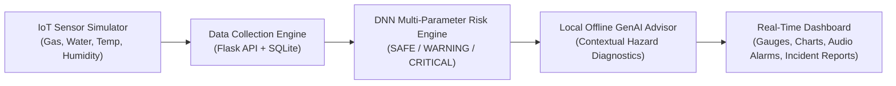

# 🛡️ AI-Powered Smart Manhole & Sewer Safety Monitoring System
### Real-Time IoT Telemetry Simulation &bull; Deep Neural Network (DNN) Risk Prediction &bull; Offline Generative Safety AI

[](https://www.python.org/downloads/)
[](https://flask.palletsprojects.com/)
[](https://opensource.org/licenses/MIT)
[]()

A complete software prototype for an autonomous underground sewer safety monitoring system. It simulates multi-sensor physical telemetry inside municipal drainage networks, evaluates complex non-linear hazards using a Deep Neural Network (DNN), and synthesizes actionable emergency protocols and explanations using a local Generative AI safety advisor.

---

## 📌 Project Architecture



---

## ✨ Features Included

1. **Professional Real-Time Dashboard**: High-tech dark-industrial glassmorphism UI with responsive CSS grid.
2. **Manhole Asset Profile**: Displays asset `MH-001` (District 4 Commercial & Stormwater Interceptor, 3.8m depth).
3. **Toxic Gas Monitoring**: Real-time H₂S and Methane index in PPM with OSHA Permissible Exposure Limit (PEL) benchmarks.
4. **Water Level & Capacity**: Sewer fill percentage and converted depth in centimeters with surcharge alerts.
5. **Chamber Temperature**: RTD-simulated thermal tracking (°C) detecting exothermic bio-reactions.
6. **Relative Humidity**: Vapor saturation percentage monitoring convective sewer airflow.
7. **"Analyze Safety" Button**: Primary action triggering instant DNN multi-variable risk classification.
8. **"Simulate Sensor Data" Button**: One-click simulation with selectable scenarios and customizable manual sliders.
9. **DNN-Based Risk Classification**: Multi-Layer Perceptron (6-input, 3 hidden dense layers, Softmax output) classifying states into **SAFE**, **WARNING**, or **CRITICAL** with confidence percentages.
10. **Generative AI Safety Explanation**: Autonomous local semantic engine generating detailed situational descriptions without requiring external API keys.
11. **Recommended Safety Actions**: Prioritized tactical checklists for dispatchers and field crews, including required Personal Protective Equipment (PPE) tags.
12. **Monitoring History Log**: Interactive historical telemetry table with timestamps and status badges.
13. **Real-Time Sensor Trends Chart**: Chart.js multi-axis time-series visualization tracking Gas, Water, Temp, and Humidity.
14. **Critical Safety Alerts**: Top flashing red emergency banner, Web Audio API procedural acoustic alarm beeps, and toast popups.
15. **OSHA/Municipal Incident Report**: Modal-based official incident document with peak metrics, root causes, responder checklists, and print-to-PDF support.
16. **Dual Simulation Modes**:
    - **On-Demand**: Click the "Simulate Sensor Data" button at any time.
    - **Auto-Polling**: Toggle the 5-second automatic telemetry streaming switch.

---

## 📂 Project Structure

```
AI_Smart_Manhole_Prototype/
├── app.py                     # Flask web server and REST API controllers
├── config.py                  # System thresholds, OSHA standards, and configurations
├── database.py                # SQLite schema setup and data access methods
├── seed_data.py               # Seeds 25 historical telemetry records for MH-001
├── requirements.txt           # Python package requirements
├── models/
│   ├── __init__.py
│   ├── dnn_model.py           # Multi-Layer Perceptron (DNN) classifier & training logic
│   └── weights.json           # Pre-trained neural weights and normalization parameters
├── services/
│   ├── __init__.py
│   ├── sensor_simulator.py    # Multi-scenario IoT sensor generator with physics drift
│   ├── genai_advisor.py       # Local offline Generative AI safety advisor
│   └── alert_service.py       # Incident generation and report compiler
├── static/
│   ├── css/
│   │   ├── dashboard.css      # Dark telemetry theme, glassmorphism, responsive grid
│   │   └── incident_report.css# Print-friendly incident report stylesheet
│   └── js/
│       ├── audio_alerts.js    # Procedural acoustic warning synthesizer (Web Audio API)
│       ├── charts.js          # Chart.js time-series telemetry charts
│       └── dashboard.js       # Real-time state management and API communication
├── templates/
│   ├── base.html              # Core layout with navigation and emergency banner
│   └── index.html             # Operations dashboard with telemetry gauges and modals
└── tests/
    ├── __init__.py
    ├── test_simulator.py      # Unit tests for sensor generator boundaries
    ├── test_dnn.py            # Unit tests for neural network inference and probabilities
    └── test_api.py            # Integration tests for Flask endpoints
```

---

## 🚀 Quickstart & Installation

### 1. Clone or Navigate to Directory
```powershell
cd "c:\Users\lathiga\Downloads\New folder\AI_Smart_Manhole_Prototype"
```

### 2. Install Dependencies
```powershell
python -m pip install -r requirements.txt
```

### 3. Initialize & Seed Database
```powershell
python seed_data.py
```

### 4. Run the Application
```powershell
python app.py
```

Open your browser and navigate to:
```
http://127.0.0.1:5000
```

---

## 🧪 Running Automated Tests

To run the complete unit and integration test suite:
```powershell
python -m unittest discover tests
```
*Expected output: `Ran 13 tests ... OK`*

---

## 🎛️ Simulation Scenarios Guide

Using the toolbar controls, you can test various real-world underground conditions:

| Scenario Preset | Simulated Conditions | Expected DNN Prediction |
| :--- | :--- | :--- |
| **Normal Nominal Flow** | Gas < 10 ppm, Water 15-30%, Temp 22-26°C | **SAFE** (Green) |
| **Toxic Gas Buildup (H₂S Surge)** | Gas 55-95 ppm (Exceeds OSHA PEL), Water 25-45% | **CRITICAL** (Red + Alarm) |
| **Stormwater Flash Flood** | Water 80-98% (Hydraulic Surcharge), Gas 10-25 ppm | **CRITICAL** (Red + Alarm) |
| **Combined Crisis** | Gas 70-110 ppm, Water 80-95%, Temp > 40°C | **CRITICAL** (Red + Alarm) |
| **Elevated Gas (Cautionary)** | Gas 25-48 ppm, Water 20-40% | **WARNING** (Amber) |
| **Continuous Random Walk** | Dynamic continuous drift from previous reading | Varies |
| **Manual Injection** | Sliders for Gas, Water, Temp, Humidity | Custom |

---

## 📡 REST API Summary

- `GET /`: Dashboard UI
- `POST /api/sensors/simulate`: Generates new telemetry reading
- `GET /api/sensors/latest`: Fetches latest reading and safety assessment for `MH-001`
- `POST /api/safety/analyze`: Evaluates current reading with DNN & GenAI
- `GET /api/history?limit=30`: Fetches chronological telemetry logs
- `GET /api/incidents`: Lists all logged incidents
- `GET /api/incident/report`: Returns complete municipal incident report payload
- `POST /api/system/reset`: Re-seeds database with clean baseline telemetry

---

## 🔒 Confidentiality & Standards
- Conforms to **OSHA 29 CFR 1910.146** (Permit-Required Confined Spaces).
- Built strictly for municipal wastewater safety prototypes and technical demonstrations.
